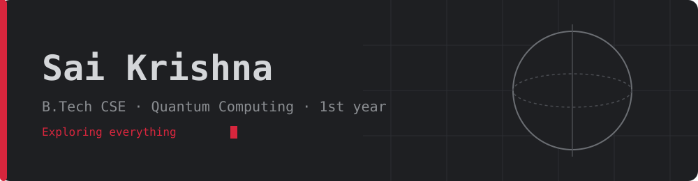

---

## Now

- **Building:** Samvaad-Setu, a computer vision project for Indian Sign Language (ISL). Just started.
- **Learning:** Python, computer vision basics, and the maths behind qubits
- **Open to:** feedback, study partners, beginner-friendly collaborations

## Projects

**Samvaad-Setu**: an ISL computer vision project. The name means "bridge of conversation". Early stage, project coming soon.

## Toolbox

## Numbers

## Find me

[LinkedIn](https://www.linkedin.com/in/sai-krishna-181497417/) · [Email](mailto:saikrishna03r@gmail.com) · Discord: monkeyddluffy_72829